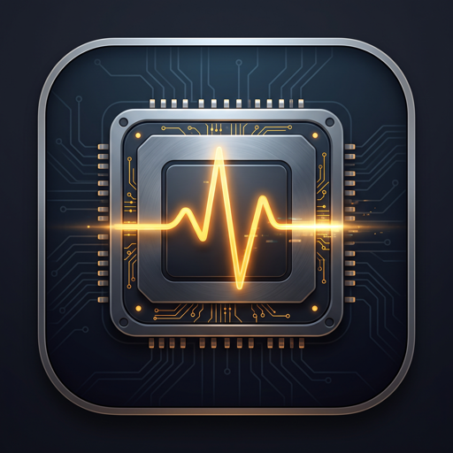
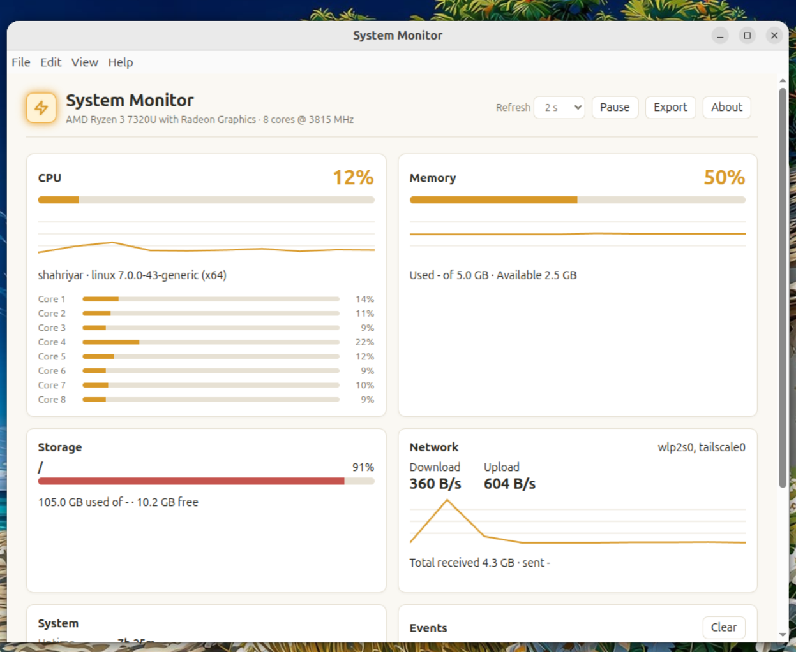
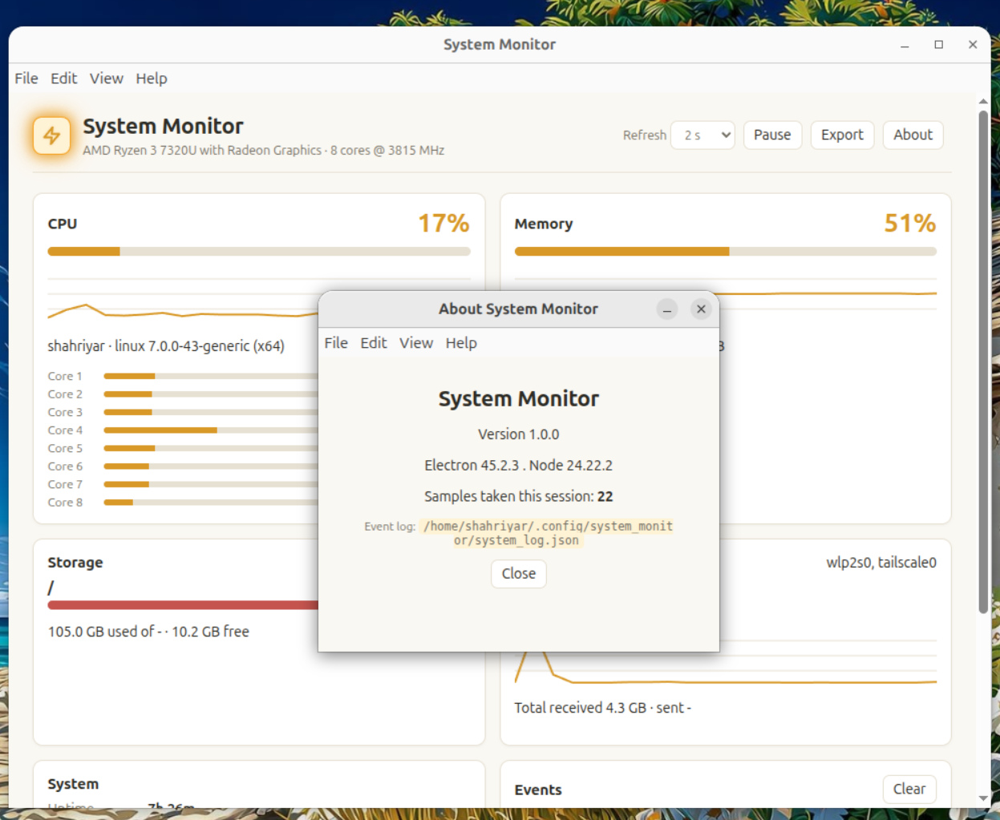

<div align="center">
  
  <h1>System Monitor</h1>
  <p>A lightweight, cross-platform desktop application built with <strong>ElectronJS</strong> for real-time hardware telemetry, live time-series graphs, and configurable threshold alerts.</p>

  <p>
    
    
    
    
  </p>
</div>

---

## Screenshots

| Home Page | About Page |
| :---: | :---: |
|  |  |

---

## Features

* **Real-Time CPU Telemetry:** Tracks overall CPU utilization and individual logical core loads using differential kernel tick sampling.
* **Platform-Aware Memory Profiling:** Accurately reports used and available RAM using `/proc/meminfo` on Linux and native OS APIs on Windows and macOS.
* **Storage & Network Monitoring:** Displays mounted disk capacity (`fs.statfsSync`) and live download/upload speeds (`Rx`/`Tx`) with cumulative totals.
* **Live Time-Series Sparklines:** Renders smooth HTML5 `<canvas>` graphs for CPU, memory, and network history with adaptive light and dark themes.
* **Threshold Alerts & Persistent Logging:** Logs threshold warnings and system events to `system_log.json` and supports one-click **JSON** and **CSV** data export.

## Installation & Usage

### Run Locally (Development)

1. Clone the repository:
   ```bash
   git clone https://github.com/Shahriyar-Rahim/System-Monitor.git
   cd System-Monitor
   ```

2. Install dependencies:
   ```bash
   npm install
   ```

3. Start the application:
   ```bash
   npm start
   ```

### Build Distributables

Generate platform-specific installers in the `dist/` directory using `electron-builder`:

* **Current OS:** `npm run dist`
* **Linux (`.deb`, `.AppImage`):** `npm run dist:linux`
* **Windows (`.exe`):** `npm run dist:win`

## Project Architecture

* **`main.js`** — Electron Main Process handling OS hardware polling, file persistence (`settings.json`, `system_log.json`), native menus, and IPC handlers.
* **`preload.js`** — Context-isolated bridge exposing secure `window.monitorApi` methods to the frontend.
* **`renderer.js`** — Renderer Process managing polling intervals, HTML5 Canvas sparklines, DOM updates, and user controls.
* **`index.html` & `style.css`** — Semantic dashboard UI with strict Content Security Policy (`default-src 'self'`) and amber-accented light/dark mode support.

## License

ISC License — Developed by [Md. Shahriyar Rahim](https://github.com/Shahriyar-Rahim).